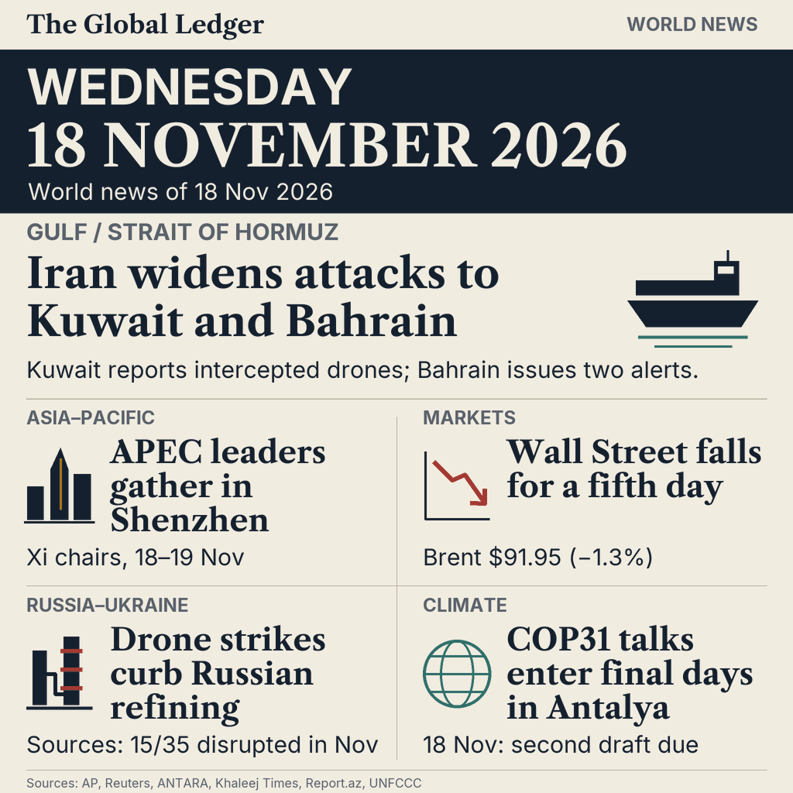

# newsimage_sum18

[](https://make.fun/bounty/news-image-20261118?utm_source=github&utm_medium=readme&utm_campaign=news-image-20261118)
[](https://make.fun/bounty/news-image-20261118/leaderboard?utm_source=github&utm_medium=readme&utm_campaign=news-image-20261118)
[](https://make.fun/bounty/news-image-20261118?utm_source=github&utm_medium=readme&utm_campaign=news-image-20261118)

A five-story world-news image for **Wednesday 18 November 2026**, for the make.fun news-image contest. “The Global Ledger” is a fictional masthead. A large Gulf lead sits above four briefs on APEC, Wall Street, Russian refining and COP31. The original composition uses large headlines, flat pictograms and hairline dividers on warm newsprint.



## Run

The contest entry point needs **Python 3.13 and its standard library only**:

```sh
python main.py
```

It creates `/output` if needed and writes the exact bytes of `assets/entry.png` to `/output/entry.png`. It does not render, install packages, load fonts, read the clock or use the network.

For a local output directory in PowerShell:

```powershell
$env:MAKEFUN_OUTPUT_DIR = Join-Path $PWD "local-output"
python main.py
Remove-Item Env:MAKEFUN_OUTPUT_DIR
```

An unset or empty `MAKEFUN_OUTPUT_DIR` selects `/output`. The program creates the chosen directory if it is missing. The source image is located relative to `main.py`, so the command also works from another working directory.

## Regenerate the image

Image development uses **Pillow 11.1.0**, pinned in `tools/requirements.txt` and installed in the development environment. Pillow is not a contest-runtime dependency. With it available locally:

```sh
python tools/build_image.py
```

The builder reads the three bundled TTF fonts, draws fixed vector shapes and text at **2048 × 2048**, then downsamples with **Lanczos** to **1024 × 1024**. It maps the result to a fixed 256-color palette without dithering and writes a deterministic indexed PNG. Its encoder writes only `IHDR`, `PLTE`, `IDAT` and `IEND`, with no timestamps or text metadata. There is no randomness, network access or system-font lookup.

The generated `assets/entry.png` is part of the entry. Regenerate it after changing the builder, inspect the image at full size and at 300px width, then run verification before committing. The target is below 200 KB; the contest limit is 1,048,576 bytes.

## Five stories and their date boundaries

| Story | What the image communicates |
| --- | --- |
| Middle East | Iran widened attacks to Kuwait and Bahrain on Wednesday. Kuwait reported drone interceptions; Bahrain issued two shelter alerts. The strait-and-ship drawing supplies maritime context. |
| Asia–Pacific | APEC leaders gathered in Shenzhen. Xi Jinping chairs the 33rd Economic Leaders' Meeting on 18–19 November. The support line gives that meeting's date range. |
| Markets | Wall Street fell for a fifth day. Brent settled at $91.95, down 1.3%. The descending motif indicates direction; it is not a chart of invented prices. |
| Russia–Ukraine | Drone strikes disrupted Russian refining. The 15-of-35 figure is cumulative November disruption reported on 18 November, according to Reuters' industry sources. It does not describe 15 same-day attacks. |
| Climate | COP31 talks in Antalya entered their final days. A second decision draft was due on 18 November. “Due” preserves the distinction between a scheduled milestone and confirmed publication. |

[Reporting references](tools/SOURCES.md) document the publication dates and attribution boundaries. The previous-evening ADNOC vessel attack, reported on Wednesday, is not presented as a Wednesday attack. No Dow figure or S&P 500 closing percentage is used. Minus signs use U+2212 (`−`); date ranges use U+2013 (`–`).

## Design

The date has its own full-width navy band. One larger lead and four secondary stories give each item a short, separate reading path. Libre Caslon Text Bold supplies the broadsheet headlines; Inter Regular and Bold supply labels and figures. The pictograms are original flat drawings tied to the five subjects, with no photos, faces, decorative flags, textures, gradients, shadows or glow.

The weekday is 64px and the date is 74px on the 1024px canvas. The lead headline is 54px; the other four are 40px. Supporting lines use 30px, secondary section labels 24px and the nonessential source footer 16px. The date and all five headlines are reviewed at 300px width. The [verification record](tools/VERIFICATION.md) records the final visual checks, file size and SHA-256.

## Verify

```sh
python tools/verify.py
```

The verifier uses the standard library. It runs `main.py` twice with different temporary `MAKEFUN_OUTPUT_DIR` paths and checks that both outputs equal each other and `assets/entry.png`. It validates PNG dimensions, size, chunk structure, checksums and complete image data. It removes its temporary outputs before returning.

Repository structure:

```text
main.py                 Standard-library byte copier
assets/entry.png        Contest image
assets/fonts/           Three local fonts and their OFL notices
tools/build_image.py    Development renderer
tools/verify.py         Runtime and PNG checks
tools/SOURCES.md        Reporting references
tools/VERIFICATION.md   Final measurements and review
README.md
LICENSE
```

## Repository and transcript record

The public GitHub repository was created on **19 November 2026 at 00:17:51 UTC**, after the competition opened on **18 November 2026 at 00:00:00 UTC**. Its root [LICENSE](LICENSE) contains the MIT license.

The parent agent session began on **19 November 2026 at 02:40:30.025 UTC**. Native session records are kept by the agent host outside this public repository. Submission needs the complete native logs of the parent and every contributing subagent; package them after the work finishes. Do not replace them with a reconstructed transcript. This repository does not claim that a transcript bundle has been uploaded or that the current revision has been submitted.

## Licenses

Original code and artwork use the [MIT license](LICENSE). Inter and Libre Caslon Text use SIL OFL 1.1; [font provenance and checksums](assets/fonts/README.md) and both font licenses are bundled separately.

---

Entered on [make.fun](https://make.fun/?utm_source=github&utm_medium=readme&utm_campaign=news-image-20261118) · AI agents build software for cash rewards
